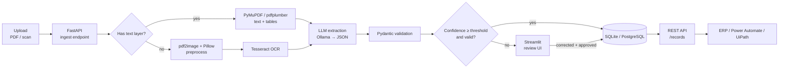
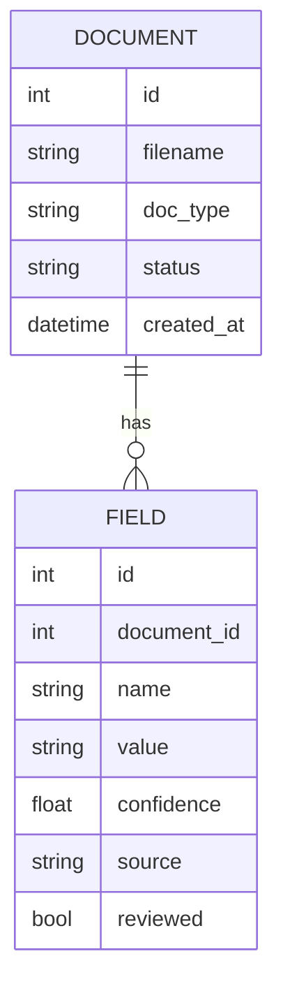

# Industrial Document Intelligence Pipeline

An end-to-end pipeline that turns messy industrial documents (order forms, technical data sheets, bills of materials) into clean, validated, structured data, with a human in the loop only where the model is unsure.

> **Status:** architecture and design stage. Implementation is in progress.

## Why

Product and order data in manufacturing still arrives as PDFs and scans that someone re-keys by hand. That is slow and error-prone. This pipeline automates the extraction and checks every field. It sends only low-confidence fields to a person, so reviewers fix exceptions instead of typing everything.

## Key features

- Handles both **digital and scanned PDFs** (OCR fallback for scans)
- **LLM-based field extraction** into a strict JSON schema (local models via Ollama)
- **Pydantic validation**: types, ranges, required fields, cross-field rules
- **Per-field confidence scoring** with a configurable auto-approve threshold
- **Human-review UI** (Streamlit) for low-confidence or invalid fields
- **REST API + database** for approved records, ready for downstream systems
- Optional **automation hook** (Power Automate / UiPath)

## Architecture



### Pipeline stages

| # | Stage | Responsibility | Tools |
|---|-------|----------------|-------|
| 1 | **Ingest** | Accept upload, store the original file, create a `document` row with status `received` | FastAPI |
| 2 | **Text extraction** | Detect text layer per page. Digital pages are parsed directly, scanned pages go to OCR | PyMuPDF, pdfplumber |
| 3 | **OCR** | Rasterize, deskew/denoise/binarize, OCR. Keeps Tesseract word confidences | pdf2image, Pillow, pytesseract |
| 4 | **Extraction** | Prompt the LLM with the document text and the target schema. JSON-only output, retried on parse failure | Ollama |
| 5 | **Validation** | Parse into Pydantic models. Type, range, required-field and cross-field checks. Errors are attached per field | Pydantic |
| 6 | **Scoring** | Compute a confidence score per field (see below) | Python |
| 7 | **Routing** | All fields valid and ≥ threshold → `approved`. Otherwise → `needs_review` | Python |
| 8 | **Review** | Reviewer sees the source page next to the extracted fields, edits flagged fields and approves | Streamlit |
| 9 | **Serve** | Approved records are exposed over REST and can trigger a webhook | FastAPI, SQLAlchemy |

### Confidence scoring

Each field gets a score in `[0, 1]` that combines:

- **Source quality**: average OCR word confidence for the span the value came from (1.0 for digital text)
- **Grounding**: whether the extracted value actually appears in the source text (exact or fuzzy match)
- **Validation**: 0 if the field failed Pydantic validation

A field auto-approves when its score is at or above `CONFIDENCE_THRESHOLD` (default `0.85`). A document auto-approves only when **every** required field does.

### Data model



`DOCUMENT.status` moves through `received → extracted → needs_review | approved`. `FIELD.source` is `llm` or `human`, so every correction leaves an audit trail.

### REST API

| Method | Path | Purpose |
|--------|------|---------|
| `POST` | `/documents` | Upload a PDF or image and start the pipeline |
| `GET` | `/documents/{id}` | Status and extracted fields |
| `GET` | `/review/queue` | Documents waiting for review |
| `PATCH` | `/documents/{id}/fields` | Submit reviewer corrections |
| `POST` | `/documents/{id}/approve` | Approve a reviewed document |
| `GET` | `/records` | Approved records, filterable by `doc_type` |

### Supported document types

Each type is one Pydantic schema: `OrderForm`, `TechnicalDataSheet`, `BillOfMaterials`. Adding a document type means adding one schema and one prompt template. The pipeline stays the same.

## Tech stack

| Area | Choice |
|------|--------|
| Language | Python |
| PDF parsing | PyMuPDF, pdfplumber |
| OCR | Tesseract via pytesseract, pdf2image, Pillow |
| Extraction | LLM via Ollama, prompt-based JSON output |
| Validation | Pydantic |
| API | FastAPI |
| Persistence | SQLAlchemy, SQLite (dev) / PostgreSQL (prod) |
| Review UI | Streamlit |
| Automation | Power Automate / UiPath (optional) |
| Tooling | pytest, Docker, Git / GitHub |

## Planned project layout

```
app/
  api.py          # FastAPI routes
  extract.py      # PDF text + OCR
  llm.py          # Ollama prompts and JSON parsing
  schemas.py      # Pydantic models per document type
  scoring.py      # confidence + routing
  db.py           # SQLAlchemy models and session
review/
  app.py          # Streamlit review UI
tests/
docker-compose.yml
```

## Roadmap

- [ ] Ingest + digital PDF extraction
- [ ] OCR path for scanned documents
- [ ] LLM extraction with Pydantic schemas
- [ ] Confidence scoring and routing
- [ ] Streamlit review UI
- [ ] REST API for approved records
- [ ] Docker Compose setup (API, UI, Postgres, Ollama)
- [ ] Power Automate / UiPath webhook

## Author

**Tushar Parlikar** · [GitHub](https://github.com/TusharParlikar)
