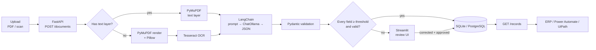
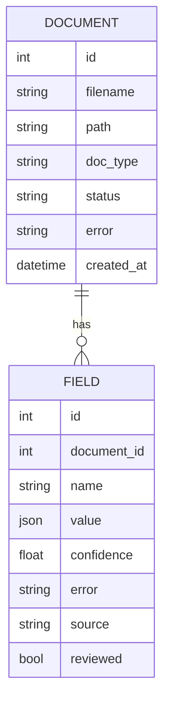

# Industrial Document Intelligence Pipeline

An end-to-end pipeline that turns messy industrial documents (order forms, technical data sheets, bills of materials) into clean, validated, structured data, with a human in the loop only where the model is unsure.

> **Status:** working MVP. Ingest, extraction, LangChain + Ollama field extraction, validation, confidence scoring, review UI and REST API all run end to end. Docker and the automation hook are next.

## Why

Product and order data in manufacturing still arrives as PDFs and scans that someone re-keys by hand. That is slow and error-prone. This pipeline automates the extraction and checks every field. It sends only low-confidence fields to a person, so reviewers fix exceptions instead of typing everything.

## Key features

- Handles both **digital and scanned PDFs** (plus PNG/JPG/TIFF), with Tesseract OCR as the fallback for scans
- **LLM field extraction with LangChain** (`ChatOllama`, runs locally), constrained to a strict JSON schema
- **Pydantic validation**: types, ranges, required fields, cross-field rules
- **Per-field confidence scoring** with a configurable auto-approve threshold
- **Human-review UI** (Streamlit) showing the source page next to the extracted fields
- **REST API + database** for approved records, ready for downstream systems
- Full **audit trail**: every field records whether its value came from the LLM or a person

## Architecture



### Pipeline stages

| # | Stage | Responsibility | Code |
|---|-------|----------------|------|
| 1 | **Ingest** | Accept upload, store it under a random name, create a `document` row with status `received` | [app/api.py](app/api.py) |
| 2 | **Text extraction** | Pages with a text layer are read directly. Pages with almost no text are treated as scans | [app/extract.py](app/extract.py) |
| 3 | **OCR** | Render at 300 DPI in grayscale, autocontrast, run Tesseract. Keeps word confidences | [app/extract.py](app/extract.py) |
| 4 | **Extraction** | LangChain chain `ChatPromptTemplate \| ChatOllama(format=schema) \| JsonOutputParser`, retried up to 3 times | [app/llm.py](app/llm.py) |
| 5 | **Validation** | Pydantic models per document type. Errors are mapped back to individual fields | [app/schemas.py](app/schemas.py), [app/scoring.py](app/scoring.py) |
| 6 | **Scoring** | Confidence per field (see below) | [app/scoring.py](app/scoring.py) |
| 7 | **Routing** | Every field valid and ≥ threshold → `approved`. Otherwise → `needs_review` | [app/scoring.py](app/scoring.py) |
| 8 | **Review** | Reviewer edits flagged fields, the record is re-validated, then approved | [review/app.py](review/app.py), [app/pipeline.py](app/pipeline.py) |
| 9 | **Serve** | Approved records are exposed over REST | [app/api.py](app/api.py) |

### Why LangChain + Ollama

The LLM call goes through LangChain, so the model is swappable (`ChatOllama` → any LangChain chat model) without touching the pipeline. Ollama's `format` option takes the Pydantic JSON schema, so the model can only produce output with the right shape. The raw dict goes through validation as a separate step, so a bad value flags one field instead of failing the whole document.

### Confidence scoring

Each field gets a score in `[0, 1]`:

```
confidence = source_quality × grounding        (0 if the field fails validation)
```

- **Source quality**: 1.0 for digital text, the mean Tesseract word confidence for OCR'd pages
- **Grounding**: fraction of the value's leaves that actually appear in the source text. Numbers match across formatting (`1,250.00` = `1250`), and ISO dates match common written formats (`03/14/2026`)
- **Missing values** score `0.5`: a `null` may be correct, or the model may have missed it, so a person confirms

A document auto-approves only when **every** field scores at or above `CONFIDENCE_THRESHOLD` (default `0.85`). A hallucinated value has grounding 0 and always goes to review.

### Data model



`DOCUMENT.status` goes `received → needs_review | approved | failed`. `FIELD.source` is `llm` or `human`.

### REST API

| Method | Path | Purpose |
|--------|------|---------|
| `POST` | `/documents` | Upload a file (`file`, `doc_type` form fields). Processing runs in the background |
| `GET` | `/documents/{id}` | Status and extracted fields |
| `GET` | `/review/queue` | Documents waiting for review |
| `PATCH` | `/documents/{id}/fields` | Submit corrections as `{"field": value}`. The record is re-validated |
| `POST` | `/documents/{id}/approve` | Approve. Returns `409` if any field is still invalid |
| `GET` | `/records?doc_type=` | Approved records as flat JSON |

Interactive docs at `http://localhost:8000/docs`.

### Supported document types

| `doc_type` | Schema | Key fields |
|------------|--------|------------|
| `order_form` | `OrderForm` | order number, date, customer, line items, total, currency |
| `technical_data_sheet` | `TechnicalDataSheet` | product, model number, material, temperature range, max pressure, weight |
| `bill_of_materials` | `BillOfMaterials` | assembly, part number, revision, items |

Adding a document type means adding one Pydantic model to `SCHEMAS`. The prompt, scoring and UI pick it up automatically.

## Quick start

**Prerequisites:** Python 3.11+, [Ollama](https://ollama.com), and [Tesseract](https://github.com/tesseract-ocr/tesseract) (only needed for scanned files).

```bash
pip install -r requirements.txt
ollama pull qwen3:1.7b

uvicorn app.api:app --reload        # API on :8000
streamlit run review/app.py         # review UI on :8501
```

Try it with the sample:

```bash
curl -F file=@samples/purchase_order.pdf -F doc_type=order_form localhost:8000/documents
curl localhost:8000/documents/1
```

### Configuration

| Variable | Default | Purpose |
|----------|---------|---------|
| `OLLAMA_MODEL` | `qwen3:1.7b` | Any Ollama model. Bigger models miss fewer fields |
| `OLLAMA_HOST` | `http://localhost:11434` | Ollama server |
| `CONFIDENCE_THRESHOLD` | `0.85` | Auto-approve cut-off |
| `DATABASE_URL` | `sqlite:///data/pipeline.db` | Any SQLAlchemy URL, e.g. `postgresql+psycopg://...` |

### Tests

```bash
python -m pytest -q
```

The tests cover grounding, routing, hallucination detection and cross-field validation, with no LLM needed.

## Project layout

```
app/
  api.py          # FastAPI routes
  extract.py      # PDF text layer + Tesseract OCR
  llm.py          # LangChain + Ollama extraction chain
  schemas.py      # Pydantic models per document type
  scoring.py      # validation, confidence, routing
  pipeline.py     # orchestration + reviewer actions
  db.py           # SQLAlchemy models and session
review/
  app.py          # Streamlit review UI
samples/          # example documents
tests/
```

## Tech stack

| Area | Choice |
|------|--------|
| Language | Python |
| PDF + OCR | PyMuPDF, Tesseract (pytesseract), Pillow |
| LLM | LangChain (`langchain-ollama`) with local Ollama models |
| Validation | Pydantic |
| API | FastAPI |
| Persistence | SQLAlchemy, SQLite (dev) / PostgreSQL (prod) |
| Review UI | Streamlit |
| Tooling | pytest, Git / GitHub |

## Roadmap

- [x] Ingest + digital PDF extraction
- [x] OCR path for scanned documents
- [x] LangChain LLM extraction with Pydantic schemas
- [x] Confidence scoring and routing
- [x] Streamlit review UI
- [x] REST API for approved records
- [ ] Automatic document-type classification (LLM)
- [ ] Chunking for long multi-page documents
- [ ] Docker Compose setup (API, UI, Postgres, Ollama)
- [ ] Power Automate / UiPath webhook on approval

## Author

**Tushar Parlikar** · [GitHub](https://github.com/TusharParlikar)
